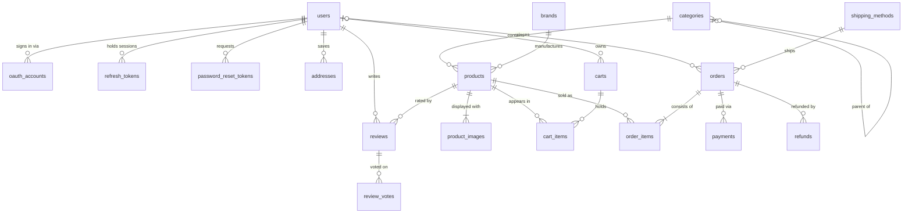

# ⚡ Voltmarket — B2C E-commerce Platform for Electric Cars

Final course task (**i-love-shopping**, Projects 1–3). Voltmarket is a
Business-to-Consumer web shop selling **electric cars and EV accessories**
(chargers, cables, tires, gear) — built API-first with a React storefront.

## Project overview

| Layer | Technology | Why |
|---|---|---|
| API | Node.js 24 + Express 4 (modular monolith, `/api/v1`) | Stateless, horizontally scalable, one language across the stack |
| Database | PostgreSQL 16 | ACID transactions, generated columns, built-in full-text search |
| Cache / rate limiting | Redis 7 | Hot catalog caching, token-bucket rate limiter, JWT revocation denylist |
| Message queue | RabbitMQ 3.13 (+ dead-letter queue) | Async order/payment processing (Project 2) |
| Frontend | React 18 + Vite + Tailwind CSS | SPA storefront, access tokens held in memory only |
| Edge | nginx + self-signed TLS | HTTPS termination, static serving, API proxy |
| Email | Mailpit (dev SMTP + web UI) | Password reset & order emails, viewable at `:8025` |
| Payments | Stripe (test mode) + Stripe CLI | PCI-friendly: card data never touches this server |

**Architecture:** a *modular monolith* — one Express app with isolated modules
(`auth`, `catalog`, `cart`, `orders`, `payments`, `reviews`, `admin`), each with
its own routes/controller/service/validation. The API is stateless (JWTs +
Redis/Postgres for shared state), so it scales horizontally behind a load
balancer; the queue worker is a separate process consuming RabbitMQ. Any module
can later be split into a microservice without rewriting business logic.

### Status

- ✅ **Project 1 — Foundation**: auth (JWT + rotation, CAPTCHA, 2FA, Google
  OAuth, password reset) with working UI pages, PostgreSQL schema + ERD,
  product catalog with faceted search/suggestions/sorting, automated test
  suite (76 tests).
- 🔜 **Project 2 — Commerce**: cart, checkout, Stripe payments, RabbitMQ order
  flow, order management.
- 🔜 **Project 3 — Experience**: full storefront UI, reviews, admin dashboard,
  security hardening, load testing.

## Entity Relationship Diagram

The full ERD with attributes, PK/FK, cardinality and modality lives in
[docs/erd.md](docs/erd.md) (rendered by GitHub/GitLab as a Mermaid diagram).
Condensed view:



## Setup & installation

**Prerequisite: Docker** (Docker Desktop or engine + compose v2). For payment
testing in Project 2 you will additionally need the
[Stripe CLI](https://docs.stripe.com/stripe-cli).

```bash
docker compose up --build
```

That single command builds and starts everything: Postgres, Redis, RabbitMQ,
Mailpit, the API, the queue worker, and nginx serving the frontend over TLS.

| URL | What |
|---|---|
| https://localhost | Storefront (self-signed cert — accept the browser warning) |
| https://localhost/api/v1/health | API health check |
| http://localhost:8025 | Mailpit — read every email the shop sends |
| http://localhost:15672 | RabbitMQ management (guest / guest) |

Optional configuration: copy `.env.example` to `.env` to set real reCAPTCHA
keys, Google OAuth credentials, or Stripe test keys. Every variable has a
working dev default (the bundled reCAPTCHA keys are Google's official public
*test* keys, which always pass).

### Demo accounts

| Email | Password | Role |
|---|---|---|
| `admin@voltmarket.local` | `Admin123!` | admin (forced to enroll 2FA on first login) |
| `demo@voltmarket.local` | `Demo123!` | customer (2FA off, so you can enroll it yourself) |

## Try it in the browser

Open https://localhost and accept the self-signed certificate warning.

1. **Register** — `/register`. Leave a field empty or type a bad email to see
   client-side validation; the reCAPTCHA checkbox must be ticked before the
   form will submit (the server verifies the token independently).
2. **Verify tokens are memory-only** — log in, then open DevTools →
   Application. `localStorage` and `sessionStorage` are **empty**, and
   `document.cookie` shows nothing (the refresh cookie is `httpOnly`). Press
   F5: you stay logged in, because the SPA silently exchanges that cookie for a
   new access token on load.
3. **Enroll 2FA** — `/account` → *Set up 2FA*. Scan the QR with Google
   Authenticator or Authy, enter the 6-digit code, and save the 8 recovery
   codes (shown once). Log out and back in: the login form grows a second step.
   A recovery code works in place of the app code, exactly once.
4. **Reset a password** — `/forgot-password`, then read the email at
   http://localhost:8025 and follow its link. Using the same link twice fails:
   reset tokens are single-use and expire after an hour.

## Usage guide (API)

```bash
# Browse with faceted search: category + brand + price range, sorted by price
curl -k 'https://localhost/api/v1/products?category=electric-cars&brand=tesla&minPrice=40000&maxPrice=55000&sort=price_asc'

# Live search suggestions (typo tolerant)
curl -k 'https://localhost/api/v1/products/suggest?q=tesle'

# Product detail (metric + imperial, images, related products)
curl -k 'https://localhost/api/v1/products/tesla-model-3-long-range'

# Register (CAPTCHA verified server-side; test keys accept any token)
curl -k -X POST https://localhost/api/v1/auth/register \
  -H 'Content-Type: application/json' \
  -d '{"email":"you@example.com","password":"Passw0rd1","name":"Your Name","captchaToken":"test"}'

# Login → the access token (15 min) is returned in JSON and kept in memory by
# the SPA; the refresh token (7 days) travels only in an httpOnly cookie.
curl -k -c jar.txt -X POST https://localhost/api/v1/auth/login \
  -H 'Content-Type: application/json' \
  -d '{"email":"demo@voltmarket.local","password":"Demo123!"}'

# Rotate the refresh token (each one is single-use; reuse revokes the family)
curl -k -b jar.txt -c jar.txt -X POST https://localhost/api/v1/auth/refresh
```

### Token model (review talking points)

- **JWT** = `header.payload.signature` (HS256). Payload carries `sub`, `role`,
  `jti`, `iat`, `exp`, `iss`.
- **Access token**: 15 min, held in SPA memory only (never local/session
  storage). Revocable via a Redis `jti` denylist (TTL = remaining lifetime).
- **Refresh token**: opaque 96-hex random value, 7 days, httpOnly
  `SameSite=Strict` cookie scoped to `/api/v1/auth`, stored **sha256-hashed**
  with a `family_id`. Every refresh rotates it; a reused token is treated as
  theft and the whole family is revoked.

## Testing

```bash
docker compose up -d postgres redis   # test infra
cd backend && npm install && npm test # 76 tests: unit, API integration, security
```

- **Unit**: JWT generation/validation/expiry/tampering, input validation
  (syntactic, semantic, whitelisting), product data model (metric+imperial).
- **API integration**: auth lifecycle incl. rotation single-use + family
  revocation, catalog browsing/facets/sorting/search, DB constraints.
- **Security**: SQL-injection & XSS payloads, malformed JSON, absurd
  pagination, helmet headers, token-bucket rate limiting (429 + Retry-After).

**Manual test checklist** (run periodically; automated bots can't cover these):

1. **CAPTCHA** — on `/register`, submit without ticking the box (blocked
   client-side), then tick it and register. With real keys, also let the widget
   expire to confirm the token is refused server-side.
2. **Google OAuth** — set `GOOGLE_CLIENT_ID`/`GOOGLE_CLIENT_SECRET`, then use
   *Continue with Google* on `/login`: full round trip, account linking to an
   existing email, and cancelling mid-flow.
3. **2FA** — enroll via QR on `/account` in Google Authenticator or Authy, log
   in with a code, spend a recovery code (works exactly once), and confirm an
   admin account cannot disable it.
4. **Encryption** — confirm HTTPS in the browser, then check the database:

   ```bash
   docker exec -it i-love-shopping-postgres-1 \
     psql -U shop -d shop -c "SELECT email, phone_enc, totp_secret_enc FROM users;"
   ```

   Both columns are AES-256-GCM ciphertext (`iv.tag.ciphertext`), never
   readable plaintext.

## Repository layout

```
backend/    Express API — src/modules/{auth,catalog,...}, migrations/, seeds/, tests/
frontend/   React SPA (Vite + Tailwind)
nginx/      TLS termination + static serving + API proxy (self-signed cert)
docs/       ERD, (later: performance report, API docs)
```

## Bonus functionality beyond the minimum

- Refresh-token **family theft detection** (reuse revokes the whole chain)
- Field-level **AES-256-GCM encryption** of PII at rest + hashed tokens
- **Generated columns** for imperial units and the search tsvector (can't drift)
- Typo-tolerant suggestions via **pg_trgm** similarity
- Facet counts that ignore their own dimension (proper faceted UX)
- Redis read-through caching + fail-open token-bucket rate limiter
- Admin 2FA enforcement at the authorization layer
- TOTP clock-skew tolerance (±1 step, RFC 6238 §5.2) so a code typed as it
  rolls over still works
- Runtime frontend config via `GET /api/v1/auth/config` — reCAPTCHA keys and
  OAuth availability change without rebuilding the SPA (twelve-factor)
- De-duplicated silent token refresh: concurrent 401s trigger one refresh, so
  parallel requests never look like refresh-token theft
