# Entity Relationship Diagram — Voltmarket

Canonical schema for the whole platform. Entities marked *(P2)* / *(P3)* arrive
with Project 2 (Commerce) and Project 3 (Experience); everything else exists
since Project 1.

Conventions: every table has a surrogate **PK** (`uuid` for user-facing
entities, serial for lookup tables). Money is stored as integer cents.
Cardinality/modality is expressed in crow's-foot notation below
(`||` exactly one, `o|` zero-or-one, `o{` zero-or-many, `|{` one-or-many).

```mermaid
erDiagram
    users {
        uuid id PK
        varchar email UK "unique, lowercased"
        varchar password_hash "null for OAuth-only"
        varchar name
        text phone_enc "AES-256-GCM encrypted PII"
        user_role role "customer|support|sales|admin"
        boolean email_verified
        boolean totp_enabled
        text totp_secret_enc "encrypted TOTP secret"
        jsonb totp_recovery_codes "sha256 hashes"
        boolean is_active
        timestamptz created_at
        timestamptz updated_at
    }

    oauth_accounts {
        uuid id PK
        uuid user_id FK
        varchar provider "e.g. google"
        varchar provider_user_id "UK with provider"
    }

    refresh_tokens {
        uuid id PK
        uuid user_id FK
        varchar token_hash UK "sha256 of raw token"
        uuid family_id "rotation chain"
        timestamptz expires_at
        timestamptz used_at "single-use marker"
        timestamptz revoked_at
        varchar user_agent
        varchar ip
    }

    password_reset_tokens {
        uuid id PK
        uuid user_id FK
        varchar token_hash UK
        timestamptz expires_at
        timestamptz used_at
    }

    audit_logs {
        bigint id PK
        uuid user_id FK "null on system actions"
        varchar action
        varchar entity
        varchar entity_id
        jsonb meta
        varchar ip
        timestamptz created_at
    }

    categories {
        int id PK
        varchar name
        varchar slug UK
        int parent_id FK "self-reference, null = root"
        text description
        int sort_order
    }

    brands {
        int id PK
        varchar name UK
        varchar slug UK
        varchar country
    }

    products {
        uuid id PK
        varchar name
        varchar slug UK
        text description
        int price_cents "CHECK >= 0"
        varchar currency
        int stock_quantity "CHECK >= 0"
        int category_id FK
        int brand_id FK
        numeric weight_kg "canonical metric"
        int length_mm
        int width_mm
        int height_mm
        numeric weight_lb "GENERATED from kg"
        numeric length_in "GENERATED from mm"
        numeric width_in "GENERATED"
        numeric height_in "GENERATED"
        int range_km "EV attribute"
        numeric battery_kwh "EV attribute"
        int motor_power_kw "EV attribute"
        jsonb attributes
        numeric rating_avg "denormalized from reviews"
        int rating_count
        boolean is_active
        tsvector search_vector "GENERATED, GIN-indexed"
    }

    product_images {
        int id PK
        uuid product_id FK
        varchar file_path
        varchar alt_text
        int sort_order
        boolean is_primary
    }

    addresses {
        uuid id PK "(P2)"
        uuid user_id FK
        text recipient_enc "encrypted PII"
        text street_enc "encrypted PII"
        varchar city
        varchar postal_code
        varchar country
        boolean is_default
    }

    carts {
        uuid id PK "(P2)"
        uuid user_id FK "null = guest cart"
        varchar guest_token UK "cookie for guests"
        timestamptz expires_at "guest carts expire"
    }

    cart_items {
        uuid id PK "(P2)"
        uuid cart_id FK
        uuid product_id FK
        int quantity "CHECK > 0"
    }

    shipping_methods {
        int id PK "(P2)"
        varchar name
        int price_cents
        varchar eta_days
        boolean is_active
    }

    orders {
        uuid id PK "(P2)"
        varchar reference UK "human order number"
        uuid user_id FK "null = guest order"
        varchar email
        order_status status "pending_payment|paid|payment_failed|processing|shipped|delivered|cancelled|refunded"
        int subtotal_cents
        int shipping_cents
        int total_cents
        int shipping_method_id FK
        jsonb shipping_address_enc "encrypted snapshot"
        timestamptz created_at
    }

    order_items {
        uuid id PK "(P2)"
        uuid order_id FK
        uuid product_id FK
        varchar name_snapshot "price/name frozen at purchase"
        int price_cents_snapshot
        int quantity
    }

    payments {
        uuid id PK "(P2)"
        uuid order_id FK
        varchar stripe_payment_intent UK
        payment_status status "pending|succeeded|failed"
        int amount_cents
        varchar failure_reason
    }

    refunds {
        uuid id PK "(P2)"
        uuid order_id FK
        uuid payment_id FK
        int amount_cents
        varchar stripe_refund_id
        varchar status
        varchar reason
    }

    reviews {
        uuid id PK "(P3)"
        uuid product_id FK
        uuid user_id FK "UK with product_id"
        int rating "CHECK 1..5"
        text body
        review_status status "pending|approved|rejected"
        timestamptz created_at
    }

    review_votes {
        uuid id PK "(P3)"
        uuid review_id FK
        uuid user_id FK "UK with review_id"
        boolean helpful
    }

    users ||--o{ oauth_accounts : "signs in via"
    users ||--o{ refresh_tokens : "holds sessions"
    users ||--o{ password_reset_tokens : "requests"
    users ||--o{ audit_logs : "performs"
    users ||--o{ addresses : "saves"
    users |o--o{ carts : "owns (guests: none)"
    users |o--o{ orders : "places (guest orders allowed)"
    users ||--o{ reviews : "writes"
    users ||--o{ review_votes : "casts"

    categories |o--o{ categories : "parent of"
    categories ||--o{ products : "contains"
    brands ||--o{ products : "manufactures"
    products ||--|{ product_images : "displayed with"
    products ||--o{ cart_items : "appears in"
    products ||--o{ order_items : "sold as"
    products ||--o{ reviews : "rated by"

    carts ||--o{ cart_items : "holds"
    orders ||--|{ order_items : "consists of"
    orders ||--o{ payments : "paid via"
    orders ||--o{ refunds : "refunded by"
    payments |o--o{ refunds : "reversed by"
    shipping_methods ||--o{ orders : "ships"
    reviews ||--o{ review_votes : "voted on"
```

## Design notes (review talking points)

- **ACID**: checkout runs in a single transaction — order + order items insert,
  stock decrement with `SELECT … FOR UPDATE` row locks (prevents overselling),
  cart clear. Either everything commits or nothing does (Atomicity). CHECK
  constraints + FKs keep every committed state valid (Consistency). Row locks
  serialize concurrent stock updates (Isolation). WAL guarantees Durability.
- **Imperial units** are Postgres `GENERATED` columns derived from canonical
  metric values — they can never drift apart.
- **Search** is a `GENERATED` weighted tsvector (name `A`, description `B`)
  with a GIN index; suggestions use a pg_trgm GIN index on `name`.
- **Order items snapshot** name and price at purchase time, so later catalog
  edits never rewrite order history (Integrity).
- **PII at rest** (phone, addresses, TOTP secrets) is AES-256-GCM encrypted at
  the field level; passwords are bcrypt-hashed; tokens are stored as sha256
  hashes only.
