# Entity Relationship Diagram — Voltmarket

Canonical schema for the whole platform. Everything here exists and is in use
except the entities marked *(P3)*, which arrive with Project 3 (Experience):
`reviews` and `review_votes`.

Conventions: every table has a surrogate **PK** (`uuid` for user-facing
entities, serial for lookup tables). Money is stored as integer cents.
Cardinality/modality is expressed in crow's-foot notation below
(`||` exactly one, `o|` zero-or-one, `o{` zero-or-many, `|{` one-or-many).

```mermaid
erDiagram
    users {
        uuid id PK
        varchar email UK "unique, lowercased"
        varchar password_hash "null for OAuth-only"
        varchar name
        text phone_enc "AES-256-GCM encrypted PII"
        user_role role "customer|support|sales|admin"
        boolean email_verified
        boolean totp_enabled
        text totp_secret_enc "encrypted TOTP secret"
        jsonb totp_recovery_codes "sha256 hashes"
        boolean is_active
        timestamptz created_at
        timestamptz updated_at
    }

    oauth_accounts {
        uuid id PK
        uuid user_id FK
        varchar provider "e.g. google"
        varchar provider_user_id "UK with provider"
    }

    refresh_tokens {
        uuid id PK
        uuid user_id FK
        varchar token_hash UK "sha256 of raw token"
        uuid family_id "rotation chain"
        timestamptz expires_at
        timestamptz used_at "single-use marker"
        timestamptz revoked_at
        varchar user_agent
        varchar ip
    }

    password_reset_tokens {
        uuid id PK
        uuid user_id FK
        varchar token_hash UK
        timestamptz expires_at
        timestamptz used_at
    }

    audit_logs {
        bigint id PK
        uuid user_id FK "null on system actions"
        varchar action
        varchar entity
        varchar entity_id
        jsonb meta
        varchar ip
        timestamptz created_at
    }

    categories {
        int id PK
        varchar name
        varchar slug UK
        int parent_id FK "self-reference, null = root"
        text description
        int sort_order
    }

    brands {
        int id PK
        varchar name UK
        varchar slug UK
        varchar country
    }

    products {
        uuid id PK
        varchar name
        varchar slug UK
        text description
        int price_cents "CHECK >= 0"
        varchar currency
        int stock_quantity "CHECK >= 0"
        int category_id FK
        int brand_id FK
        numeric weight_kg "canonical metric"
        int length_mm
        int width_mm
        int height_mm
        numeric weight_lb "GENERATED from kg"
        numeric length_in "GENERATED from mm"
        numeric width_in "GENERATED"
        numeric height_in "GENERATED"
        int range_km "EV attribute"
        numeric battery_kwh "EV attribute"
        int motor_power_kw "EV attribute"
        jsonb attributes
        numeric rating_avg "denormalized from reviews"
        int rating_count
        boolean is_active
        tsvector search_vector "GENERATED, GIN-indexed"
    }

    product_images {
        int id PK
        uuid product_id FK
        varchar file_path
        varchar alt_text
        int sort_order
        boolean is_primary
    }

    addresses {
        uuid id PK
        uuid user_id FK
        text recipient_enc "encrypted PII"
        text street_enc "encrypted PII"
        varchar city
        varchar postal_code
        varchar country
        boolean is_default
    }

    carts {
        uuid id PK
        uuid user_id FK "null = guest cart"
        varchar guest_token UK "cookie for guests"
        timestamptz expires_at "guest carts expire"
    }

    cart_items {
        uuid id PK
        uuid cart_id FK
        uuid product_id FK
        int quantity "CHECK > 0"
    }

    shipping_methods {
        int id PK
        varchar name
        int price_cents
        varchar eta_days
        boolean is_active
    }

    orders {
        uuid id PK
        varchar reference UK "human order number"
        uuid user_id FK "null = guest order"
        text email_enc "AES-256-GCM encrypted buyer email"
        varchar email_hash "HMAC blind index — lets guests look an order up"
        order_status status "pending_payment|paid|payment_failed|processing|shipped|delivered|cancelled|refunded"
        int subtotal_cents
        int shipping_cents
        int total_cents
        int shipping_method_id FK
        jsonb shipping_address_enc "encrypted snapshot"
        timestamptz created_at
    }

    order_items {
        uuid id PK
        uuid order_id FK
        uuid product_id FK
        varchar name_snapshot "price/name frozen at purchase"
        int price_cents_snapshot
        int quantity
    }

    payments {
        uuid id PK
        uuid order_id FK
        varchar provider "stripe"
        varchar provider_payment_id UK "Stripe PaymentIntent id — no card data"
        payment_status status "pending|succeeded|failed|cancelled"
        int amount_cents
        varchar currency
        varchar failure_code
        text failure_message
    }

    order_events {
        bigint id PK
        uuid order_id FK
        varchar status
        text note
        timestamptz created_at
    }

    processed_events {
        varchar event_key PK "idempotency guard: stripe:evt_… or queue:evt_…"
        varchar source "stripe | queue"
        jsonb meta
        timestamptz processed_at
    }

    refunds {
        uuid id PK
        uuid order_id FK
        uuid payment_id FK
        int amount_cents
        varchar stripe_refund_id
        varchar status
        varchar reason
    }

    reviews {
        uuid id PK "(P3)"
        uuid product_id FK
        uuid user_id FK "UK with product_id"
        int rating "CHECK 1..5"
        text body
        review_status status "pending|approved|rejected"
        timestamptz created_at
    }

    review_votes {
        uuid id PK "(P3)"
        uuid review_id FK
        uuid user_id FK "UK with review_id"
        boolean helpful
    }

    users ||--o{ oauth_accounts : "signs in via"
    users ||--o{ refresh_tokens : "holds sessions"
    users ||--o{ password_reset_tokens : "requests"
    users ||--o{ audit_logs : "performs"
    users ||--o{ addresses : "saves"
    users |o--o{ carts : "owns (guests: none)"
    users |o--o{ orders : "places (guest orders allowed)"
    users ||--o{ reviews : "writes"
    users ||--o{ review_votes : "casts"

    categories |o--o{ categories : "parent of"
    categories ||--o{ products : "contains"
    brands ||--o{ products : "manufactures"
    products ||--|{ product_images : "displayed with"
    products ||--o{ cart_items : "appears in"
    products ||--o{ order_items : "sold as"
    products ||--o{ reviews : "rated by"

    carts ||--o{ cart_items : "holds"
    orders ||--|{ order_items : "consists of"
    orders ||--|{ order_events : "status history"
    orders ||--o{ payments : "paid via"
    orders ||--o{ refunds : "refunded by"
    payments |o--o{ refunds : "reversed by"
    shipping_methods ||--o{ orders : "ships"
    reviews ||--o{ review_votes : "voted on"
```

## Design notes (review talking points)

- **ACID**: checkout runs in a single transaction — lock the product rows,
  re-validate stock, insert the order and its items, decrement stock, clear
  the cart. Either everything commits or nothing does (Atomicity). CHECK
  constraints and FKs keep every committed state valid (Consistency). The
  `FOR UPDATE` row locks serialise concurrent checkouts, which is what makes
  overselling impossible (Isolation). The write-ahead log means a crash after
  "order placed" cannot lose it (Durability).
  Implemented in `backend/src/modules/orders/orders.service.js` → `createOrder`.
- **Encrypted at rest**: `orders.email_enc` and `shipping_address_enc` are
  AES-256-GCM ciphertext. Because AES-GCM is randomised it cannot be searched,
  so `email_hash` stores an HMAC blind index — deterministic enough for a guest
  to look up their order, but not brute-forceable without the key.
- **No cardholder data, anywhere**: `payments` holds only Stripe's own
  reference. There is no column that could store a card number, expiry or CVC,
  which is a stronger position than encrypting them would be.
- **Imperial units** are Postgres `GENERATED` columns derived from canonical
  metric values — they can never drift apart.
- **Search** is a `GENERATED` weighted tsvector (name `A`, description `B`)
  with a GIN index; suggestions use a pg_trgm GIN index on `name`.
- **Order items snapshot** name and price at purchase time, so later catalog
  edits never rewrite order history (Integrity).
- **PII at rest** (phone, addresses, TOTP secrets) is AES-256-GCM encrypted at
  the field level; passwords are bcrypt-hashed; tokens are stored as sha256
  hashes only.
